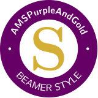

# beamer-AMSPurpleAndGold



> A simple Beamer-LaTeX style for presentations by Alma Mater Studiorum —
> Università di Bologna, in the Cesena Purple and the golds of the old
> AMSCesenaPurpleAndGold style, recovered

## author

* Andrea Omicini

## usage

```latex
\documentclass[presentation]{beamer}\mode<presentation>{\usetheme{AMSPurpleAndGold}}
```

Everything else is AMSUniBo's: the `apice` option for the APICe BibTeX field,
the `bologna` and `cesena` options for the seal watermark — none unless asked
for — and the commands and the bibliography style. The old styles
always carried the Campus di Cesena seal, so a deck moved from them wants
`cesena`:

```latex
\documentclass[presentation,cesena,apice]{beamer}\mode<presentation>{\usetheme{AMSPurpleAndGold}}
```

A ready-to-use presentation skeleton is available in
[beamer-AMSPurpleAndGold-template](https://github.com/andreaomicini/beamer-AMSPurpleAndGold-template).

## relation to beamer-AMSUniBo and to AMSCesenaPurpleAndGold

This style is [beamer-AMSUniBo](https://github.com/andreaomicini/beamer-AMSUniBo)
with a different palette, exactly as
[beamer-AMSBolognaFC](https://github.com/andreaomicini/beamer-AMSBolognaFC) is:
the theme is AMSUniBo's, generated from it with every colour name replaced and
a handful of assignments changed where a role needed a different shade. The
options, the commands (`\speaker`, `\ccite`, `\uurl`, `\ddoi`, `\apicepubpar`,
`\aalert`, since 1.1 the APICe addresses `\apice`, `\apicesite`, `\apicepage`,
and their pairs, since 1.2 the talk and thesis markers `\apicetalkpar` and
`\apicethesispar`), the workarounds, the references frame and
`apalike-AMS.bst`—since 1.2 AMSUniBo 1.7.3's, with talks, theses and
subtitles—are all AMSUniBo's — see
[its README](https://github.com/andreaomicini/beamer-AMSUniBo#readme) for all of
them. The faces are not: like AMSBolognaFC, this style keeps LaTeX's own
Computer Modern, as the old one did, rather than AMSUniBo's Merriweather.

The palette is the one thing that is not, and it is a **recovery**.
`AMSCesenaPurpleAndGold` (2019) defined *Cesena Purple* `#660066`, *Gold
(metallic)* `#D4AF38`, *Pale Goldenrod* `#EDE8AB` and a plain purple, in a
colour theme of its own, whose structure AMSBolognaFC's colour theme still
shares line for line. It was copied into some forty decks, in five variants
that never differ in the colours themselves.

The old style was not satisfying, so only its colours were kept. They were
extracted from every copy of the style found in the archive, as the shades it
actually used, and assigned to the roles AMSUniBo's palette has. Where a role
had no counterpart in the old style, the colour was guessed from the existing
ones, and the colour theme says so beside it.

## structure

<!-- markdownlint-disable MD013 -->
| file | what it is |
| --- | --- |
| `beamerthemeAMSPurpleAndGold.sty` | the theme: AMSUniBo's, in this palette |
| `beamercolorthemepurpleandgold.sty` | the palette alone, with the provenance of each colour, loaded by the theme |
| `almabologna-background.pdf` | the background under the `bologna` option: the Ateneo seal, as in AMSUniBo |
| `almacesena-background.pdf` | the same, with the Campus di Cesena seal, for the `cesena` option |
| `apalike-AMS.bst` | the bibliography style, AMSUniBo's |

<!-- markdownlint-enable MD013 -->

Every release attaches a `style.zip` holding all five plus the `LICENSE`.

## the palette

**Gold is the identity colour** — the head line, links, bullets, alerts — as
AMSUniBo's red is; **purple is the structural one**, as its green is.

<!-- markdownlint-disable MD013 -->
| colour | value | source | where it goes on a slide |
| --- | --- | --- | --- |
| `pggold` | `#D4AF38` | Gold (metallic), gold(metallic) in AMSCesenaPurpleAndGold | head line |
| `pggolddark` | `#7F6922` | gold(metallic)!60!black, guessed: the darkest gold still read as gold, at AA on white | author, bullets, alerted text, URLs, DOIs |
| `pggoldpale` | `#EDE8AB` | Pale Goldenrod, palegoldenrod in AMSCesenaPurpleAndGold | titles over purple: block headers, the author in the foot line |
| `pgpurple` | `#660066` | Cesena Purple, cesenapurple in AMSCesenaPurpleAndGold | structure, block headers, emphasis, section in TOC, separation lines, the APICe marker |
| `pgpurpledeep` | `#380038` | cesenapurple!55!black, P&G block title | alerted block headers; text on the gold head line |
| `pgpurplelight` | `#D1B2D1` | cesenapurple!30!white, P&G example block title | reserved |
| `pgpurpletint` | `#F4EDF4` | cesenapurple!7!white, P&G example block body | frame title band, block bodies, foot line |
| `pgpurpletint2` | `#E8D9E8` | cesenapurple!15!white, guessed: between tint and light | foot line, frame title right |
| `pgblack` | `#000000` | black | title, frame titles |
| `pgtext` | `#0A000A` | cesenapurple!10!black, P&G normal text | body text |
| `pggrey` | `#4A304A` | guessed: darkgray with a purple cast | institute |
| `pggreymid` | `#5D445D` | cesenapurple!25!gray darkened to AA, P&G footnote | secondary text, footnotes, subtitle, date |
| `pggreyline` | `#BEBA89` | palegoldenrod!80!black, P&G \cccite and \uuurl | `\ccite`, `\uuurl`, `\dddoi`, `\aalert`, fine rules |
| `pggreybg` | `#EDE8AB` | palegoldenrod, the lightest of the pair | `\cccite`, the lightest of the pair |
| `pggoldfill` | `#F9F5E5` | derived as amsredfill (13%) | alerted block body |
| `pggoldborder` | `#F3E8C5` | derived as amsredborder (29%) | reserved |
| `pgpurplefill` | `#F4EDF4` | cesenapurple!7!white, P&G example body | example block body |
| `pgpurpleborder` | `#D1B2D1` | cesenapurple!30!white, P&G example title | example block header |

<!-- markdownlint-enable MD013 -->

Gold itself reads at only 2.10:1 on white, which is why the old style's gold
text never quite worked. `pggolddark` is the gold darkened until it reads:
5.32:1 on white, 4.63:1 on a block body. Bright `pggold` is kept for the head
line, under `pgpurpledeep` text at 8.15:1. White on `pgpurple` would be 11.95:1,
but block headers carry `pggoldpale` instead, at 9.52:1 — the old style's own
pairing. Every text-on-fill pair is at WCAG AA or better, the quiet
light-on-dark commands aside: `\ccite` (`pggreyline`) is 6.02:1 on a block
header and 8.63:1 on an alerted one.

The fills follow AMSUniBo's derivation where they are new: the alerted fill and
border are the identity colour at 13% and 29%, as `amsredfill` and
`amsredborder` are `amsred`.

## versioning

The style version is declared in `beamerthemeAMSPurpleAndGold.sty` as
`\stylemajor` / `\styleminor` / `\stylepatch`, giving `Major.Minor[.Patch]`.
`\stylepatch` is optional: comment it out to release as `Major.Minor`.

Releases are tagged `Major.Minor[.Patch]-<UTC time-stamp>`, with the time-stamp
appended automatically by the CI at release time.

## licence

This work is distributed under the
[LaTeX Project Public License](LICENSE), version 1.3c or later, and has the
LPPL maintenance status `maintained`.

One file is **not** covered by that licence: `apalike-AMS.bst` is a modified,
renamed derivative of Oren Patashnik's `apalike.bst` (Copyright © 1988, 2010
Oren Patashnik) and remains subject to its own terms, which permit modification
and redistribution provided the resulting file is renamed — as it is here.
